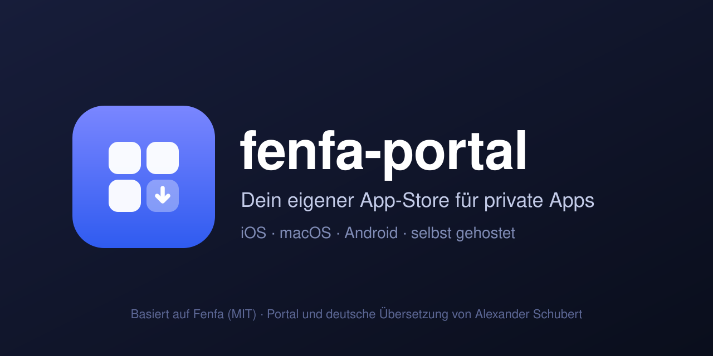

<p align="center"></p>

# fenfa-portal

Ein eigener App-Store für private Apps, in einem Docker-Container, als Unraid-Template installierbar.

> **Basiert auf [Fenfa](https://github.com/openprx/fenfa)** (MIT) von den Fenfa-Entwicklern. Von mir stammen nur die Ergänzungen: das **Portal** (Startseite, Login, Icons), die **deutsche Übersetzung** und die Einrichtung als ein Container mit Unraid-Template. Dies ist kein offizielles Fenfa-Projekt.

- **Verteil-Server:** [Fenfa](https://github.com/openprx/fenfa) (MIT) verteilt iOS-, Android- und macOS-Builds. Für iOS erzeugt es das `manifest.plist` und den `itms-services://`-Link (Ad-hoc-OTA).
- **Portal:** Startseite im App-Store-Stil mit Passwort-Login, Install-Buttons pro Plattform und Icon-Upload.
- **Ein Port:** Ein eingebauter nginx leitet `/` und `/portal/` an das Portal, alles andere an Fenfa. Der Nginx Proxy Manager braucht keine Sonderregeln.

```
Mac (Xcode)  --release.sh-->  fenfa-portal (Unraid)  <--Safari--  iPhone / iPad / Mac
                               ├─ nginx :8080
                               ├─ Portal  (Startseite, Login, Icons)
                               └─ Fenfa   (Admin, Downloads, iOS-Manifest)
```

## Voraussetzungen

- Ein Apple-Developer-Konto (99 $/Jahr). Ad-hoc-Profile gelten **1 Jahr**, danach erneuern und neu signieren.
- Die UDIDs deiner Geräte im Developer-Portal (max. 100 pro Gerätetyp und Jahr).
- Eine **https-Adresse mit gültigem Zertifikat**, sonst installiert iOS nicht. Am einfachsten über den Nginx Proxy Manager mit einer Domain und DNS-Challenge. Die Adresse muss nicht aus dem Internet erreichbar sein, sie muss nur vom Gerät aus (Heimnetz oder VPN) auflösbar sein.

## Installation auf Unraid

**Mit Template (nach dem GitHub-Upload):** Template-URL `https://raw.githubusercontent.com/alexanderschubert/fenfa-portal/main/unraid/fenfa-portal.xml` unter Docker, Add Container, Template-Auswahl eintragen. Oder die Datei nach `/boot/config/plugins/dockerMan/templates-user/` kopieren.

**Vor dem GitHub-Upload (lokal bauen):**

```bash
cd /mnt/user/appdata/fenfa-portal-src      # dieser Ordner
docker build -t fenfa-portal:local .
cp unraid/fenfa-portal-local.xml /boot/config/plugins/dockerMan/templates-user/
```

Dann im Docker-Tab **Add Container** und das Template `fenfa-portal` wählen.

Im Template füllst du aus:

| Feld | Bedeutung |
|---|---|
| Web-Port | Standard `7011`, dorthin zeigt der Nginx Proxy Manager |
| Öffentliche URL | z. B. `https://apps.example.com` (ohne Slash am Ende) |
| Admin-Token, Upload-Token, Passwort | leer lassen, dann werden sie erzeugt |

Beim ersten Start stehen die erzeugten Zugangsdaten **einmalig im Container-Log** und dauerhaft in `data/credentials.env`.

### Nginx Proxy Manager

Proxy Host auf `http://UNRAID-IP:7011`, SSL-Zertifikat, „Force SSL“, Websockets an. Im Tab **Advanced**:

```
client_max_body_size 1g;
```

Sonst scheitern große IPA-Uploads.

## Benutzung

1. `https://apps.example.com/admin` öffnen und mit dem Admin-Token anmelden.
2. **Produkt** anlegen, darin eine **Variante** (iOS, macOS, ...). Die Variant-ID holst du über die API:
   `curl -s -H "X-Auth-Token: ADMIN_TOKEN" http://UNRAID-IP:7011/admin/api/products/PRODUKT_ID`
3. Auf dem Mac `~/.fenfa.env` anlegen (siehe `mac/release.sh`) und bauen und hochladen:
   `mac/release.sh MeinScheme 1.0.0 1`
   Vorher in `mac/ExportOptions.plist` die Team-ID eintragen. Alternativ die IPA im Admin über **Upload New Version** hochladen.
4. `https://apps.example.com/` zeigt die Übersicht. Auf dem iPhone in **Safari** öffnen und auf Installieren tippen.

Icons: Unten auf der Startseite **Einstellungen**, pro App ein Bild wählen. Ohne eigenes Icon wird eines mit dem Anfangsbuchstaben erzeugt.

## Sicherheit

- Das Passwort schützt die Startseite und die Einstellungen. Die Download-Links (`/products/...`, `/d/...`, `/ios/...`) laufen direkt über Fenfa und sind nur durch ihre zufälligen IDs geschützt. iOS lädt IPA und Manifest ohne Cookie, ein Login davor ist technisch nicht möglich. Wer die Apps nicht öffentlich haben will, beschränkt den Zugriff im Proxy auf das Heimnetz oder ein VPN.
- Das Portal bekommt den Fenfa-Admin-Token, weil nur die Admin-API die Produktliste liefert. Es zeigt nur App-Namen, Versionen und Download-Links.
- Nach 5 falschen Passwörtern wird die Anmeldung für 10 Minuten gesperrt.

## Sprache

Admin-Oberfläche und öffentliche Produktseiten sind auf Deutsch (Standard). Das Admin-Menü unten links wechselt zwischen Deutsch, Englisch und Chinesisch. Die öffentliche Seite richtet sich nach der Browsersprache (Deutsch, Chinesisch, sonst Englisch). Die Übersetzung liegt in `overlay/` und wird beim Bauen über den Fenfa-Quellcode gelegt, dazu kommen drei kleine Textersetzungen im Dockerfile. Nicht übersetzt sind einzelne technische Fehlermeldungen des Servers, zum Beispiel beim Aufruf eines Manifests ohne iOS-Gerät.

## Update

Fenfa wird in einer festen Version aus dem Quellcode gebaut (`FENFA_REF` im Dockerfile, ein Commit-Hash oder Tag, aktuell der Stand vom 7. April 2026). Eine neuere Version baust du mit:

```bash
docker build --build-arg FENFA_REF=<commit-oder-tag> -t fenfa-portal:local .
```

Daten und Zugangsdaten bleiben in `/data` erhalten. Bei einer neuen Fenfa-Version prüfen, ob die Dateien in `overlay/` noch zum Original passen, sonst bricht der Build mit einer Fehlermeldung ab.

## Von getrennten Containern umziehen

Wer Fenfa und das Portal bisher als zwei Container betreibt: beide stoppen, den alten `data`-Ordner als `/data` und den alten `uploads`-Ordner als `/app/uploads` einbinden, die alten Tokens in den Template-Feldern eintragen. Der NPM-Proxy zeigt dann nur noch auf den einen Port, die zwei `location`-Regeln entfallen.

## Lizenz und Herkunft

Fenfa ist das Werk der Fenfa-Entwickler (MIT-Lizenz, siehe [openprx/fenfa](https://github.com/openprx/fenfa)). Das Image enthält dessen Lizenztext unter `/licenses/fenfa-LICENSE`. Meine Ergänzungen (Portal, Übersetzung, Container-Einrichtung, Skripte) stehen ebenfalls unter der MIT-Lizenz, siehe [LICENSE](LICENSE) und [NOTICE](NOTICE).
